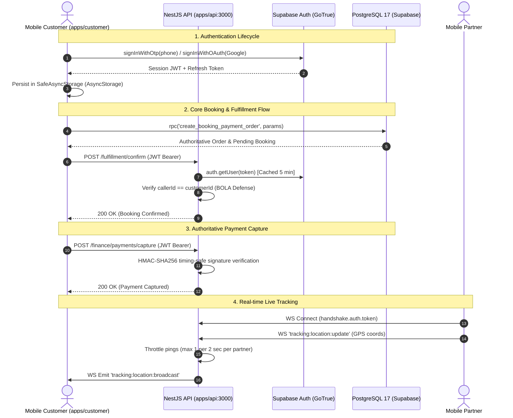

# 01 — ARCHITECTURE & SENSITIVE DATA FLOWS

## 1. System Topology Overview

Serventica operates a dual-data-plane architecture split across a bare React Native client, a NestJS backend microservice, and Supabase managed PostgreSQL infrastructure:

---

## 2. Trust Boundaries & Verification Gates

| Trust Boundary | Intersecting Components | Enforcement Mechanism | Assessment Finding |
|---|---|---|---|
| **TB-1: Mobile Client $\to$ Backend API** | `apps/customer` $\to$ `apps/api` | `SupabaseAuthGuard` (JWT Bearer) + `ThrottlerGuard` | **Secured** after adding Auth Guard to `FinanceController` and BOLA bindings to `FulfillmentController`. |
| **TB-2: Mobile Client $\to$ Database RPCs** | `apps/customer` $\to$ PostgreSQL | Supabase `anon` / `authenticated` JWT | **Hardened via Migration** (revoked `anon` execute on state-mutating RPCs; added `auth.uid()` checks). |
| **TB-3: WebSocket Gateway $\to$ Realtime Clients** | `TrackingGateway` $\to$ Sockets | Handshake token + room authorization | **Rate-limited (2000ms ping window & 500 connection cap)**. |
| **TB-4: Server $\to$ Third-Party Gateways** | `apps/api` $\to$ Razorpay / Maps | Server-side HMAC-SHA256 validation | **Hardened**: Removed `sig_` backdoor; enforced `crypto.timingSafeEqual`. |

---

## 3. Sensitive Data Flow Classification

| Data Asset | Storage Location | Transit Protocol | Classification | Controls |
|---|---|---|---|---|
| **Customer Auth Tokens** | AsyncStorage | HTTPS / WSS | Confidential | Vulnerable to extraction on rooted devices; Keystore migration required. |
| **Customer Physical Location** | `addresses` table, live sockets | HTTPS / WSS | PII / Confidential | RLS restricts access to owner customer and assigned partner. |
| **Partner Live GPS Coordinates** | In-memory socket rooms, `tracking_sessions` | WSS | Sensitive | Broadcasted only to subscribers authorized for the active `bookingId`. |
| **Financial Ledger Entries** | `ledger_entries`, `payments` | HTTPS | Restricted Financial | Double-entry balanced; modification restricted to `service_role`. |
| **Third-Party API Credentials** | Environment variables, `.env` | Server runtime | Secret | Server-side only; prohibited from mobile client bundling. |
